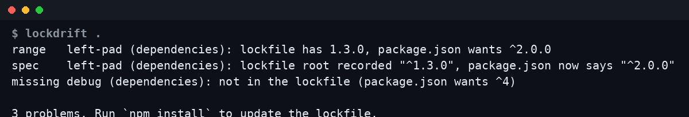

# lockdrift

Explains why `npm ci` would reject your `package-lock.json`, without installing
anything or touching the network. Zero dependencies, one file plus a small
semver checker.

`npm ci` fails with "package.json and package-lock.json are not in sync" and
leaves you to guess which dependency. lockdrift names it.



```
$ npx github:TheRealAlexxx/lockdrift .
range   left-pad (dependencies): lockfile has 1.3.0, package.json wants ^2.0.0
spec    left-pad (dependencies): lockfile root recorded "^1.3.0", package.json now says "^2.0.0"
missing debug (dependencies): not in the lockfile (package.json wants ^4)

3 problems. Run `npm install` to update the lockfile.
```

Or just `node lockdrift.js [dir]`. A drifted demo project ships in the
repo, so you can see real output without breaking your own lockfile:

```
$ npx github:TheRealAlexxx/lockdrift examples/drifted
range   left-pad (dependencies): lockfile has 1.3.0, package.json wants ^2.0.0
spec    left-pad (dependencies): lockfile root recorded "^1.3.0", package.json now says "^2.0.0"
missing debug (dependencies): not in the lockfile (package.json wants ^4)

3 problems. Run `npm install` to update the lockfile.
``` Add `--json` for machine-readable output. `npm-shrinkwrap.json` is read when there is no `package-lock.json`. Exit code 0 when in sync, 1 on drift, 2 when
a file is missing, so it works as a CI pre-check.

## What it checks

| kind    | meaning |
| ------- | ------- |
| missing | a dependency in package.json has no entry in the lockfile |
| range   | the locked version does not satisfy the range in package.json |
| spec    | the range recorded in the lockfile root differs from package.json |
| extra   | the lockfile root lists a dependency that was removed from package.json |

Covers `dependencies`, `devDependencies` and `optionalDependencies`, in lockfile
v1 (limited to missing and range) and v2/v3. Git URLs, `file:` paths and tags
can't be compared and are skipped rather than flagged.

`semver.js` handles `^`, `~`, comparators, x-ranges, hyphen ranges, `||` and the
prerelease rule. It was checked against a lockfile generated by real npm.

## Not covered

Transitive dependencies, peer dependencies, workspaces and integrity hashes.

## Tests

```
node --test
```

## License

MIT
